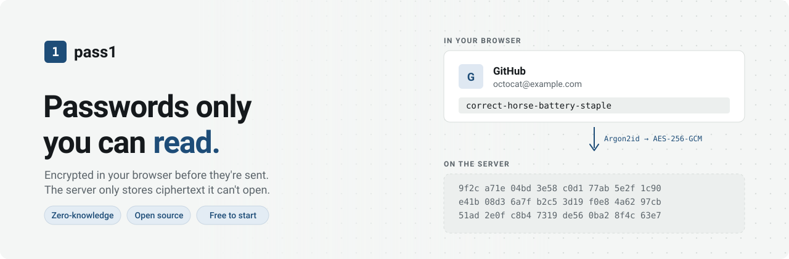

<picture>
  <source media="(prefers-color-scheme: dark)" srcset="docs/assets/banner-dark.svg">
  
</picture>

# pass1

A zero-knowledge password manager for the web. Your vault is encrypted in the browser before it is sent anywhere, so the server only ever stores ciphertext it cannot read.

> 🚧 Work in progress. See the [roadmap](#roadmap).

## How it works

```
master password ──Argon2id(salt)──► master key (never leaves the browser)
                                       │
                        HKDF ┌─────────┴─────────┐
                             ▼                   ▼
                      encryption key          auth key ──► sent to server,
                             │                              stored as Argon2id(auth key)
                             ▼
              unwraps a random VAULT KEY (stored encrypted on the server)
                             │
                             ▼
       each item: AES-256-GCM(vault key, random IV, AAD = item ID, padded JSON{name, url, username, password, notes})
```

- **The server never sees the master password or any plaintext.** It receives an auth key derived through HKDF, which can't be used to recover the encryption key.
- **A random vault key, wrapped by the master key.** Changing the master password re-wraps one key instead of re-encrypting every item.
- **Whole-item encryption.** Site names and URLs are encrypted too.
- **Padding.** Each item is padded to a multiple of 256 bytes, so the size of the ciphertext doesn't reveal how long a password is.
- **Bound to its ID.** The item ID is authenticated with the ciphertext (AES-GCM associated data), so a server that swaps two items' ciphertexts causes decryption to fail instead of showing the wrong password.
- **Versioned.** Every stored blob carries a format version, and a pinned test vector makes sure existing vaults keep decrypting.
- **Standard primitives only:** Argon2id (via `hash-wasm`), HKDF-SHA256 and AES-256-GCM (via the Web Crypto API).

The latest security review, with every finding and accepted risk: [docs/security-review.md](docs/security-review.md).

## Threat model

| Protects against | Does not protect against |
|---|---|
| Database leak or server breach | Malware or a keylogger on the user's device |
| A malicious server operator reading vaults | A compromised server serving malicious JavaScript (a limit of every web-based password manager) |
| Traffic interception | Weak master passwords (Argon2id slows guessing but can't prevent it) |
| Guessing a master password through the login form, from one machine or many | A malicious server rolling an item back to an older version, or hiding an item |

**What the server can see:** your email; how many items you have and their sizes (padded to 256 bytes); when each was created, changed or moved to the trash; and, for each logged-in device, the browser name and when it was last used. It never sees item names, websites, usernames, passwords or notes, and it doesn't log IP addresses.

**There is no account recovery.** If the master password is lost, the vault cannot be decrypted. That is the point of zero knowledge.

## Project structure

```
packages/crypto   Key derivation, vault key wrapping, item encryption + tests
packages/shared   zod schemas for API requests and responses, plan limits
apps/api          Fastify + TypeScript REST API, Drizzle ORM on Postgres (PGlite in development)
apps/web          React + TypeScript + Vite client
apps/e2e          Playwright end-to-end tests against the production build
```

## Getting started

Requires Node.js 22+.

```bash
npm install
npm test            # run all tests
npm run dev:api     # API on http://localhost:3000 (database in apps/api/data/pglite, no setup needed)
npm run dev:web     # web app on http://localhost:5173
npm run test:e2e    # builds, then runs the browser tests (uses your installed Google Chrome)
```

Deploying to a server: [docs/deploy.md](docs/deploy.md).

## Plans

| | Free | pass1 Plus | pass1 Unlimited |
|---|---|---|---|
| Items / storage | 500 / 10 MB | 5,000 / 100 MB | Unlimited (1 GB fair-use cap) |
| Yearly | $0 | $19 | $39 |
| Monthly | | $2.49 | $4.49 |
| Features | Everything in the vault | + TOTP codes, breach report, file attachments | + emergency access, priority support |

Defined in one file, [packages/shared/src/plans.ts](packages/shared/src/plans.ts). The paid features in the last row aren't built yet (see To do).

## Roadmap

### Done

- [x] Monorepo (npm workspaces), TypeScript, CI
- [x] Crypto: Argon2id, HKDF, a wrapped random vault key, AES-256-GCM items
- [x] Versioned crypto format v1: item ID bound as associated data, items padded to 256-byte buckets, a pinned test vector
- [x] Shared zod schemas for every request and response, used by the API and the web app
- [x] Postgres with Drizzle migrations; PGlite (Postgres in WebAssembly) in development and tests, and CI also runs the API tests on Postgres 18
- [x] Config from env, validated at startup
- [x] Auth: prelogin with fake salts for unknown emails, register, login, logout; hashed session tokens in an httpOnly, Secure, SameSite=Strict cookie
- [x] Rate limits, security headers, Origin check on every request that changes data, per-account login throttle
- [x] Register screen with strength meter and "no recovery" acknowledgment; unlock screen; Argon2id in a Web Worker
- [x] Keys in memory only; reloading or locking clears them, verified with Chrome heap snapshots
- [x] Vault: create, edit, trash, restore, favorites, search, keyboard shortcuts; three panes with a resizable list, stacked on mobile
- [x] Stale edits rejected by revision number instead of overwriting newer data
- [x] Plan limits enforced by the server (items, total bytes, size per item), with a usage meter in the sidebar
- [x] Password generator, auto-lock, clipboard auto-clear with countdown
- [x] Password health: reused and weak passwords, found in the browser
- [x] Settings in a dialog, including appearance and density
- [x] Change master password (re-wraps the vault key, ends other sessions)
- [x] Encrypted export and import; import from Chrome, Edge, Safari, Bitwarden and 1Password
- [x] Active sessions list with revoke; account deletion
- [x] Strict Content-Security-Policy (no inline scripts, no eval, Trusted Types, per-load style nonce)
- [x] Playwright end-to-end tests, each one also failing on any CSP violation
- [x] Docker image (non-root, read-only filesystem) and Compose stack: Caddy (HTTPS), app, Postgres, daily backups
- [x] Backup and restore scripts, tested by restoring onto a fresh stack; guide in [docs/deploy.md](docs/deploy.md)
- [x] Health check that includes the database, JSON request logs without bodies
- [x] Security review of the whole app ([docs/security-review.md](docs/security-review.md)), findings fixed and tested
- [x] Paddle checkout and customer portal; signed webhooks update the plan, applied once and in order
- [x] Paddle's script runs only on a separate checkout origin, never where vaults are decrypted
- [x] Downgrade or failed payment never deletes data: over the limit, the vault becomes read-only
- [x] "Get pass1 Plus" in the sidebar and a plans dialog with yearly and monthly prices

### To do

- [ ] One real checkout through Paddle's sandbox ([docs/deploy.md](docs/deploy.md#billing-with-paddle))
- [ ] Paid features: TOTP codes, breach report (HIBP k-anonymity), file attachments, emergency access
- [ ] Error tracking (Sentry or similar, with nothing sensitive in reports)
- [ ] Email verification, privacy-friendly CAPTCHA and rate limits on sign-up
- [ ] Landing page that explains the security model in plain words
- [ ] Terms of service and privacy policy
- [ ] `security.txt`, a vulnerability disclosure policy, a status page
- [ ] Reproducible builds, with a published hash of every release
- [ ] TOTP 2FA and passkeys for logging in
- [ ] Browser extension
- [ ] Independent security audit, with the report published

## License

[MIT](./LICENSE)
